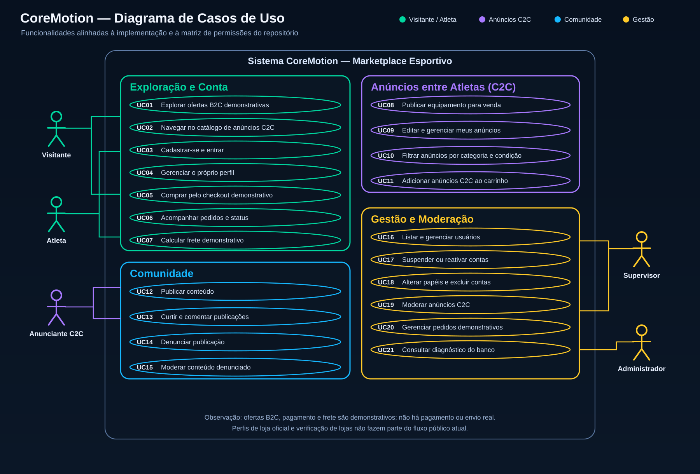

# Diagrama de Casos de Uso — CoreMotion

O diagrama atualizado representa os atores e as funcionalidades documentadas no repositório. As ofertas B2C, o checkout, o frete e os pedidos são demonstrativos; a compra interna é limitada aos anúncios C2C. Os papéis ativos são Visitante, Atleta/Usuário, Supervisor e Administrador. O papel legado `seller` é tratado como anunciante C2C e não concede permissões de loja.

Arquivo vetorial: [caso-de-uso-atual.svg](caso-de-uso-atual.svg)

Fonte de referência: [README do projeto](../../README.md), seção “Funcionalidades” e “Papéis e permissões”.
